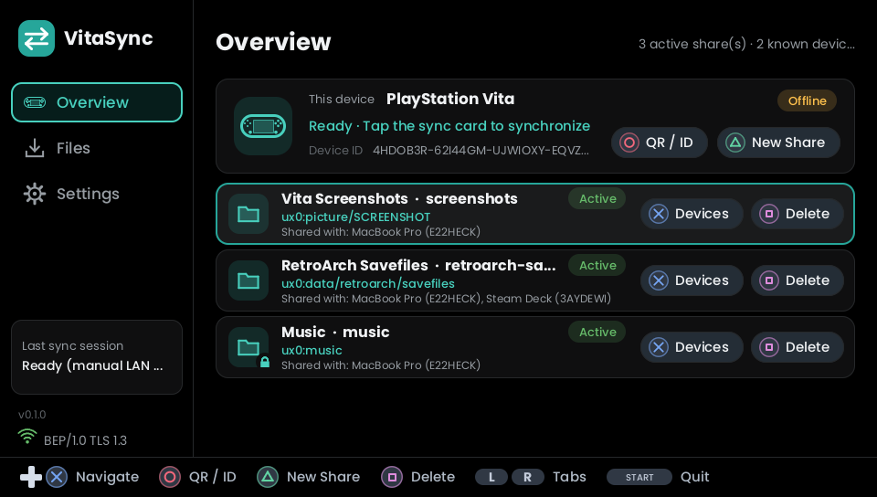
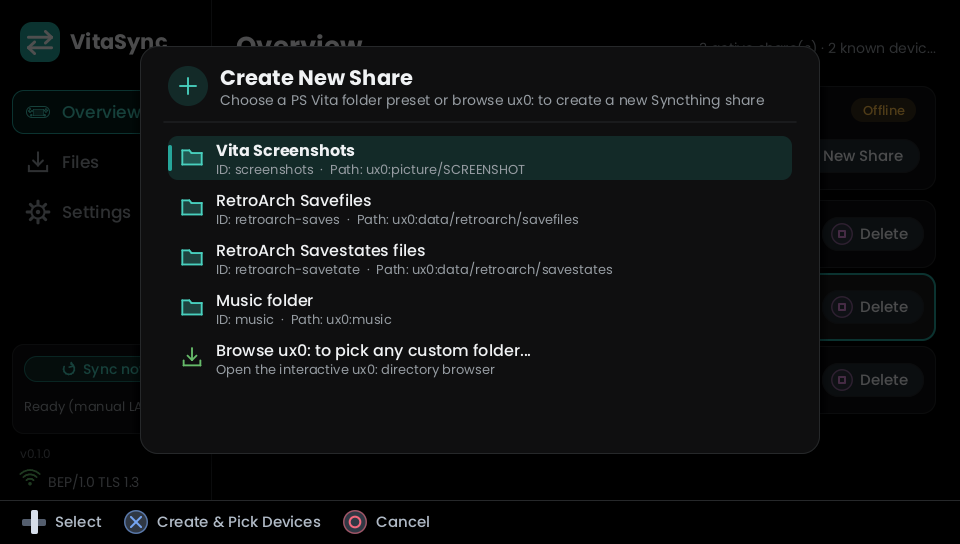
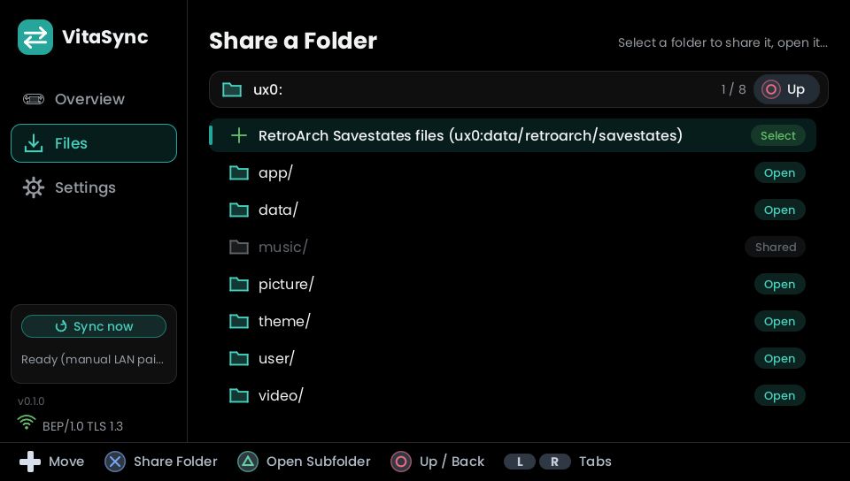
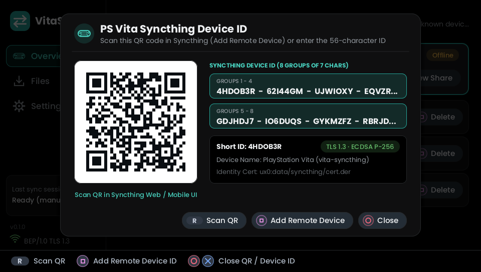
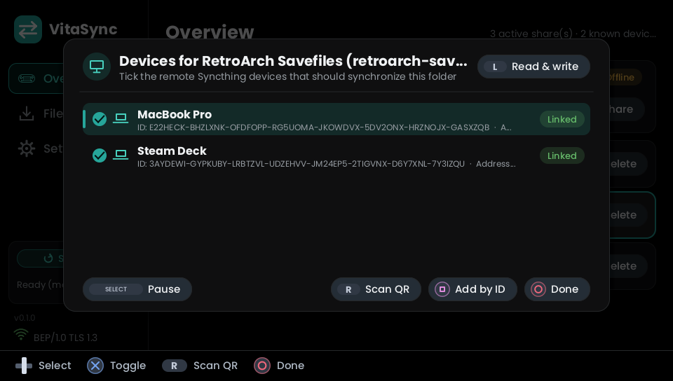
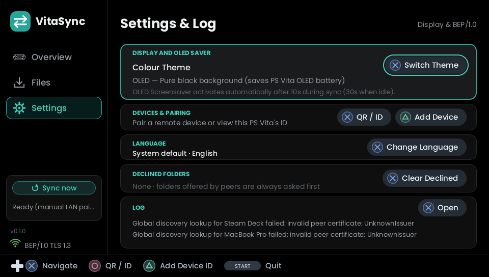

# Syncthing for PS Vita

**Keep your PlayStation Vita in sync with the rest of your devices.** Save files, RetroArch
states, screenshots and music travel between your Vita, your computer, your Steam Deck or your
phone, over your home Wi-Fi or across the Internet, with no cloud account and no USB cable.

This is a native PS Vita client for [Syncthing](https://syncthing.net), written from scratch in
Rust. It speaks the real Syncthing protocol (BEP/1.0 over TLS 1.3), so it pairs with the
official Syncthing apps you already run: there is nothing to install on the other side.

<p align="center">
  
</p>

> **Status:** early but usable (v0.1.0). It syncs real folders with desktop Syncthing every
> day, and it is written to never lose a file, but keep a backup of anything you would hate to
> lose, as with any young sync tool.

---

## What's new since v0.1.0

Landed on `main` after [v0.1.0](https://github.com/GeoffreyMetais/syncthing-vita/releases/tag/v0.1.0),
not tagged yet:

- **The Vita is now reachable inbound**: it listens on TCP port 22000, joins a public relay and
  announces itself on Global Discovery, even with no paired device. Unknown devices that connect
  get a consent dialog (accept / decline / decide later).
- **Send Only shares** alongside Receive Only, with *Override Changes*; the **Vita game saves
  preset** (`ux0:user/00/savedata`) is back.
- **Touch-drag scrolling** of the share list and of the log viewer.
- **Faster, more reliable off-LAN sync**: Global Discovery starts at launch, LAN addresses win
  over public IPs, and behind a NAT the app advertises its relay (or the UPnP/NAT-PMP mapped
  port) instead of an unreachable address.
- **Protocol fixes and features** in `syncthing-core`: no more disconnects from real Syncthing
  servers, LZ4 compression, `.stignore`, rolling weak-hash block reuse, secondary 1+2
  connections, extended metadata / Unix symlinks / introducer devices, `.stversions` versioning,
  Receive Encrypted folders.
- **Security and quality**: all `cargo audit` vulnerabilities fixed, TLS 1.2 ChaCha20 hardened,
  and CI now covers E2E sync over LAN and the Internet, including inbound scenarios.

See [CHANGELOG.md](CHANGELOG.md) for the full list.

---

## What you can do with it

### Sync the folders that matter on a Vita

- **One-tap presets** for the usual suspects: Vita game saves (`ux0:user/00/savedata`), Vita
  screenshots (`ux0:picture/SCREENSHOT`), RetroArch save files and save states, your music
  folder.
- **Any other folder**: the `Files` tab browses `ux0:` so you can share whatever you like.
  Folders that are already shared are greyed out, and the app's own data directory is protected.
- **`.stignore` files are honored** when scanning and pulling, with the same pattern syntax as
  desktop Syncthing.
- **Several devices per folder**: link a folder to your PC *and* your Steam Deck, and edits made
  anywhere end up everywhere. Up to four devices sync at the same time.
- **Receive-only and send-only shares**: switch a folder to *Receive Only* and the Vita will
  receive changes without ever pushing its own — *Revert Local Changes* puts the folder back to
  what your other devices have if something changed locally anyway. *Send Only* does the
  opposite: it pushes your changes and never pulls remote ones, and *Override Changes* forces
  your version onto the other devices.
- **Pause** any share without losing its configuration.

<p align="center">
  
  
</p>

### Pair devices without typing 56 characters on a D-pad

- The **QR / ID** screen shows the Vita's Device ID as a QR code: scan it with the Syncthing app
  on your phone, or paste the ID in Syncthing's web UI.
- Going the other way, **Scan QR** uses the Vita's rear camera to read another device's ID.
- Devices on the same Wi-Fi are **discovered automatically** and appear in the device list,
  ready to be ticked.
- You can also type a **short ID** (the first group) and let LAN discovery fill in the rest.
- The Vita also **listens for incoming connections** (TCP, relay, Global Discovery): a device
  you have not paired that tries to connect triggers a dialog where you accept it, decline it,
  or decide later.

<p align="center">
  
  
</p>

### Works at home and away

- **Local Discovery** finds your devices on the LAN in a couple of seconds; when a peer is on
  the same network, its LAN address is preferred over its public one.
- **Global Discovery** and **public relays** let the Vita reach your devices when you are not on
  the same network, the same way any Syncthing device does.
- The Vita is also **reachable inbound**: it listens on TCP port 22000, joins a public relay and
  announces itself on Global Discovery, so your other devices can connect straight to it. Behind
  a NAT it advertises its relay address — or the external port mapped automatically with
  UPnP/NAT-PMP when the router supports it — instead of an unreachable public IP.

### You stay in control

- A folder offered by another device is **never synced without your consent**: the Vita asks
  you to accept it, decline it, or decide later. Accepted folders start paused until you pick
  where they go.
- A **device you have not paired** that connects to the Vita is never added without your consent
  either: accept, decline, or decide later from the dialog. Declined devices can be reviewed and
  cleared in *Settings*.
- Every device has its own **unique identity**, generated on first launch from the Vita's
  hardware random number generator.
- A **protocol log** (in `Settings`) tells you what happened and when, for this session or the
  whole history.

### A UI made for the Vita

- Designed for the 960x544 screen, with crisp anti-aliased text (Poppins).
- **D-pad and touch everywhere**: every button can be pressed, tapped or reached with the D-pad,
  long lists (shares, log viewer) scroll with a touch drag, and the hint bar always tells you
  which face button does what.
- **Five languages**: English, French, Spanish, German and Italian, following the system
  language by default.
- **Two themes**: Dark, and Pure Black for the OLED screen of the PS Vita 1000.
- A **screensaver** kicks in while you leave the Vita syncing on the desk.

<p align="center">
  
</p>

---

## Light on a 2011 handheld

The PS Vita has a quad-core ARM Cortex-A9 that apps run at 333 MHz, 512 MB of RAM and a
battery that does not forgive much. A good part of the work on this app went into making it
sync without draining the battery or getting in the way.

### CPU clock follows the work

The app sets the ARM clock itself, with three levels:

| Situation | Clock |
| :--- | :--- |
| Initial sync with a device (index exchange, scanning, hashing) and file transfers, plus 10 s | **333 MHz** |
| You are using the app (3 s after the last input), or scanning a QR code | **222 MHz** |
| Everything else: idle, waiting for changes, screensaver | **111 MHz** |

So the Vita runs at full speed when TLS decryption and SHA-256 hashing actually need it, and
spends the rest of its time at a third of that.

### Frames only when something changes

A classic homebrew loop redraws 60 times per second whether or not anything moved. Here the
main loop still wakes on every VBlank to read the buttons and the touch screen, but a frame is
only drawn when needed:

- on the next VBlank after you press or touch something: navigation still feels instant;
- at **30 FPS** for animations (screensaver, QR viewfinder);
- at **10 FPS** at most for background updates (sync progress, new log lines);
- **once per second** when nothing changes.

### Standby only when it helps

Standby turns Wi-Fi off and drops every connection. The app only blocks it while it is useful:
when the Vita is charging, or for two minutes after the last transfer. Otherwise the Vita goes
to sleep as usual, and reconnects to your devices when it wakes up.

### Careful with memory

- Files are **streamed block by block** into a hidden temporary file, never loaded whole, so a
  2 GB file needs no more RAM than a 2 KB one.
- **Delta sync**: when a file changes, only the blocks that differ are downloaded. Block
  matching uses a rolling weak hash, so even a file shifted by an insertion only re-downloads
  what actually changed, and BEP messages are LZ4-compressed when that makes them smaller.
- Everything that grows from outside input is **bounded**: discovered LAN devices, concurrent
  sessions, the in-memory log (200 lines), the log history viewer (2,000 lines), the glyph cache.
- UI strings in all five languages are **static catalogs**: drawing a frame does not allocate
  text.
- The framebuffer lives in the Vita's video memory (CDRAM) when available, and the binary is
  built with LTO and size optimization.
- On disk, the log rotates at 512 KiB, and the folder databases are saved in batches during
  downloads instead of after every file, to spare the memory card.

### Robust by default

- A file is **never deleted before its replacement is complete**: downloads, folder databases
  and settings are written to a temporary file first, with a backup restored if the app or the
  Vita stops halfway.
- A scan that cannot read a file **never** reports it as deleted to your other devices.
- Every downloaded block is checked against its SHA-256 hash before it is kept.
- Names and sizes sent by other devices are validated before they touch the file system or
  the memory allocator.

---

## Installation

You need a PS Vita (or PS TV) running homebrew (HENkaku / Ensō), with **Enable Unsafe
Homebrew** turned on in *HENkaku Settings*: the app needs full homebrew permissions to read
and write your save data, pictures and music.

1. Download `SYNCTHING.vpk` from the
   [latest release](https://github.com/GeoffreyMetais/syncthing-vita/releases/latest), or get
   it from VitaDB.
2. Install it with VitaShell.
3. Launch **Syncthing** from the LiveArea.

### First sync

1. On the Vita, open **QR / ID** (`Circle` on the Overview).
2. On your computer, in Syncthing, choose **Add Remote Device** and scan or paste the Vita's ID.
3. On the Vita, create a share (`Triangle` · **New Share**, or the `Files` tab), then tick your
   computer in the device list. If it is on the same Wi-Fi, it shows up on its own; otherwise
   add it by ID or with **Scan QR**.
4. Accept the folder on your computer, pick where it goes, and let it sync.

The Vita connects *to* your other devices, and also accepts incoming connections on TCP port
22000, so desktop Syncthing can reach it directly too — no setup needed on your side. A device
you have not paired is always asked for your consent before it can sync.

All the app's state lives in `ux0:data/syncthing/`.

---

## The rest of the repository

The Vita app is built on two other crates, which also live here:

- **[`syncthing-core`](crates/syncthing-core)**: a platform-independent Syncthing library in
  pure Rust: BEP/1.0 codecs (LZ4 compression, `DownloadProgress`, secondary 1+2 connections),
  TLS 1.3 transport (pure-Rust crypto, no OpenSSL or `ring`, so it cross-compiles for the Vita),
  Local and Global Discovery, relays, UPnP/NAT-PMP port mapping, folder scanning and pulls with
  `.stignore` filtering and `.stversions` versioning, crash-safe storage. Nothing Vita-specific
  in it.
- **[`syncthing-cli`](crates/syncthing-cli)**: a small command-line Syncthing client for Linux
  and macOS built on the same library. Handy as a lightweight peer for the Vita, and it is
  what the end-to-end tests sync against.

Each has its own README with the details.

---

## Building from source

The repository uses [`just`](https://github.com/casey/just) as a task runner.

```bash
just setup        # Rust nightly, VitaSDK and Vita3K (once)
```

```bash
cargo test --workspace   # host tests for the three crates
```

```bash
just vpk          # target/armv7-sony-vita-newlibeabihf/release/SYNCTHING.vpk
```

```bash
just run-vita3k   # build, install and launch in the Vita3K emulator
```

Contributors (human or AI) should read [`AGENTS.md`](AGENTS.md) first: it describes the
architecture, the real-hardware constraints the emulator will not catch, and the testing rules.

---

## Credits & license

- [Syncthing](https://syncthing.net) and its open protocol, which made this possible.
- [VitaSDK](https://vitasdk.org) and the Rust `armv7-sony-vita-newlibeabihf` target.
- [Vita3K](https://vita3k.org), for testing without flashing a console every five minutes.
- The [Poppins](https://fonts.google.com/specimen/Poppins) typeface (SIL Open Font License 1.1).

This project is not affiliated with the Syncthing Foundation or with Sony.

Released under the terms of the [LICENSE](LICENSE) file (GNU GPL v3).
